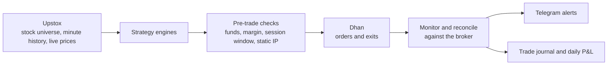

# Trading research: NIFTY options and NSE intraday strategies

Backtesting research and a live trading system I built in 2026.

The strategy and bot code is in private repositories. This page covers how the research was tested, what it found, and how the live system works. Entry and exit rules and strategy parameters are not published.

## What I built

- **Backtesting engines** for intraday strategies on NSE stocks and NIFTY options, using 2020–2025 minute data and 1-second tick data.
- **A live trading bot** that reads market data from Upstox and places orders through Dhan, running on AWS EC2.

## How the research was tested

- **Real costs on every trade:** brokerage, STT, exchange charges, SEBI fees, stamp duty and GST, plus slippage on each options leg.
- **No lookahead:** stock selection uses only data from before the trade date, and the options backtest enters on the candle after a breakout, never on the breakout candle itself.
- **Tick-level fills:** for the options strategy, trades were replayed on 1-second prints to settle whether the stop or the target was hit first inside a bar. Years with only minute data were tested with the stop assumed to hit first, the cautious choice.
- **Bugs found and fixed:** reviewing an older options backtest turned up three:
  - re-entries were scanned from the original entry instead of from the stop-loss exit
  - option entries could use the same candle as the breakout, which is lookahead
  - yearly drawdown did not reset each calendar year

## Results

### NIFTY options strategy, verified on tick data

| How the signal is traded | Years tested | Positive years | Profit factor by year |
|---|---|---|---|
| Synthetic futures | 2020–2025 | All six | 1.20 to 1.39 |
| Option selling | 2020–2025 | All six | 1.36 to 1.72 |

2021 and 2023–2025 were verified on 1-second tick data. 2020 and 2022 were tested on minute data with the stop assumed to hit first. Before trading it live, the strategy has to pass a forward paper-trading gate with recorded real fills.

### A claim that did not hold up

A report on the original version of this idea claimed a profit factor of 3.41. Re-running the same signals with no costs at all topped out at about 1.5, so the claim could not be reproduced. The original version did have a real edge before costs, but it disappeared after them, because the stop was smaller than the trading friction. Rescaling the risk to fit real costs is what made the strategy survive.

### Stock strategies, minute data

I backtested opening-range breakout, gap-based and contrarian strategies on NSE stocks over 2020–2025, with full costs. These results come from minute bars and have not been verified on tick data, so they are not published here.

## The live trading system

- **Data and execution are split:** Upstox supplies the universe, history and live prices, and Dhan executes. The bot can price entries from Upstox when Dhan's data APIs are not subscribed.
- **Automatic login:** the Dhan access token is generated from the account PIN and a TOTP secret, so the bot starts without anyone logging in by hand.
- **Guards before any order:** the bot refuses to start after the latest allowed start time, checks that the server's public IP matches the one registered with the broker, and checks funds and margin before ordering.
- **History first:** minute history is bootstrapped and refreshed before trading, and the bot stops if the history is incomplete.
- **Reconciliation:** the bot's own record of open positions is checked against the broker's, with an alert on any mismatch. Every event goes into a run journal, and a script pulls any day's per-strategy P&L from the session logs.
- **Paper mode:** a single switch runs the bot without placing real orders.
- **Deployment:** AWS EC2 under systemd, with alerts on Telegram.

## Tech

Python, pandas, NumPy, Dhan and Upstox APIs (REST and WebSocket), Telegram Bot API, AWS EC2, systemd.

## Contact

The code is private, and I'm happy to walk through it in an interview: vkhirehalli@gmail.com
