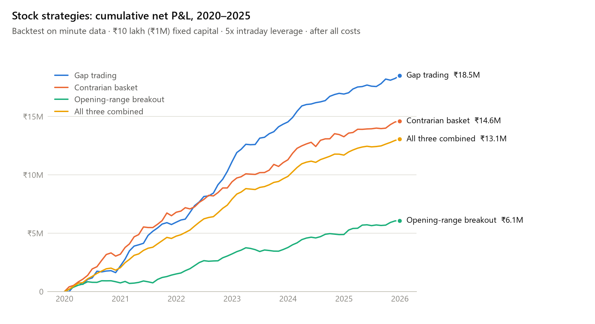
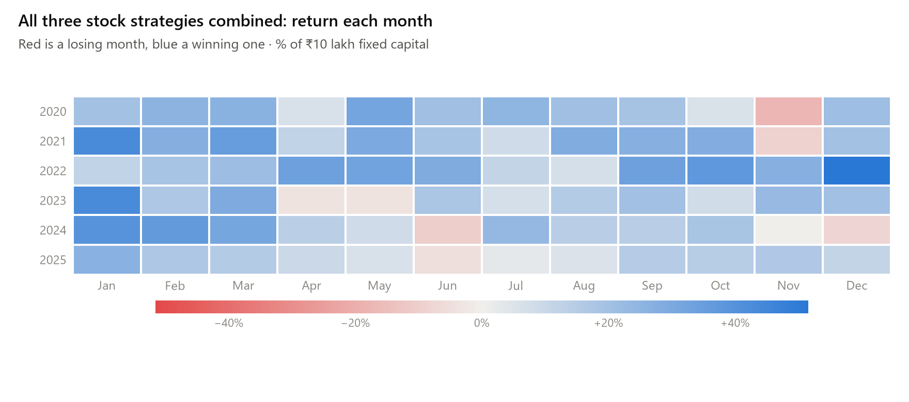
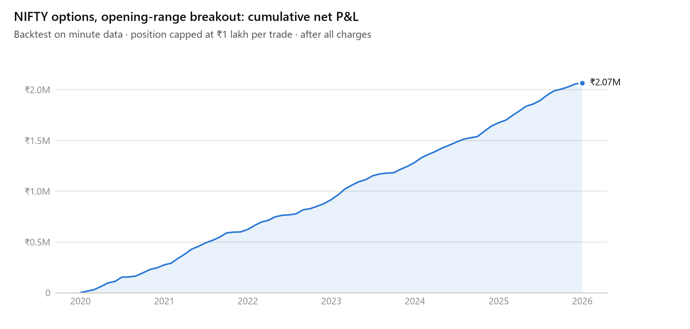
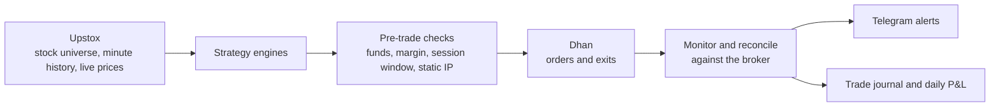

# Trading research: NIFTY options and NSE intraday strategies

Backtesting research and a live trading system I built in 2026.

The strategy and bot code is in private repositories. This page shows what each strategy does in plain words, its profit and loss, how it was tested, and how the live system works. Entry and exit rules and strategy parameters are not published.

## Results at a glance

| Strategy | Market | Tested on | Net P&L, 2020–2025 |
|---|---|---|---|
| Fair value gap (FVG) | NIFTY options | 1-second ticks in four of the six years | ₹0.76M to ₹1.18M per lot |
| Gap trading | NSE stocks | Minute bars | ₹18.5M on ₹1M capital |
| Contrarian basket | NSE stocks | Minute bars | ₹14.6M on ₹1M capital |
| Opening-range breakout | NSE stocks | Minute bars | ₹6.1M on ₹1M capital |
| All three stock strategies combined | NSE stocks | Minute bars | ₹13.1M on ₹1M capital |
| Opening-range breakout | NIFTY options | Minute bars | ₹2.07M, at up to ₹1 lakh per trade |

All figures are after brokerage, taxes and exchange charges. ₹10 lakh is ₹1 million (₹1M).

## Read this first

- **Only the FVG strategy was checked on tick data.** It is the result I trust most, and it also has the most modest returns.
- **Everything else is a minute-bar backtest.** Nothing here is a live trading record. Returns this large usually shrink a lot in real trading, because of real fills, bid-ask spreads, liquidity, and the chance that rules fitted to the past stop working.
- **The stock strategies use 5x intraday leverage.** That is why the returns are so high, and it is also why their worst losing stretches took 27% to 42% of capital.
- **The gap strategy looked weak when tested separately on 2026 data.**
- **The options breakout prices trades from 1-minute option candles**, so real bid-ask spreads would cost more than shown.

## NIFTY options: fair value gap (FVG), verified on tick data

**The idea:** a fast move can leave a "gap" in price, a zone the market skipped through. The strategy waits for NIFTY to come back to that zone and trades the retest through options.

| How the signal is traded | Net P&L, 2020–2025, one lot | Positive years | Profit factor by year | Worst losing stretch |
|---|---|---|---|---|
| Synthetic futures (buy one option, sell the other) | about ₹1.18M | All six | 1.20 to 1.39 | about ₹60,000 |
| Selling an option | about ₹0.76M | All six | 1.36 to 1.72 | about ₹28,000 |

2021 and 2023–2025 were replayed on 1-second tick data. 2020 and 2022 had only minute data, so they were tested assuming the stop was hit before the target whenever both fell inside the same bar, the cautious choice. 2020, the COVID year, was the best year for the option-selling version. Before trading it live, the strategy has to pass a forward paper-trading gate with recorded real fills.

## NSE stocks: three intraday strategies

- **Gap trading:** trades stocks on days they open with a large gap from the previous close, picking only stocks where its pattern has worked reliably in recent months.
- **Contrarian basket:** bets against stocks that have run up hard, expecting part of the move to give back. A small basket is traded each day.
- **Opening-range breakout:** marks the high and low of the first minutes of trading and trades a strong break out of that range. It re-tunes itself for each stock from recent history and trades only the stocks where it has worked best.
- **All three combined:** one-third of capital in each, to see whether their bad stretches cancel out.

<picture>
  <source media="(prefers-color-scheme: dark)" srcset="charts/stocks-cumulative-dark.png">
  
</picture>

Each strategy starts with ₹10 lakh of fixed capital, and profits are not reinvested.

| Strategy | Net P&L | Worst losing stretch | Worst month | Sharpe ratio | Winning days |
|---|---|---|---|---|---|
| Gap trading | ₹18.5M | −35% | −17% | 4.2 | 56% |
| Contrarian basket | ₹14.6M | −38% | −36% | 3.3 | 52% |
| Opening-range breakout | ₹6.1M | −42% | −17% | 2.2 | 51% |
| All three combined | ₹13.1M | −27% | −17% | 4.8 | 56% |

Losses are a percentage of the ₹10 lakh starting capital.

**Net P&L by year (₹M)**

| Year | Gap trading | Contrarian basket | Opening-range breakout | All three combined |
|---|---|---|---|---|
| 2020 | 2.19 | 3.21 | 0.75 | 2.05 |
| 2021 | 3.75 | 3.60 | 0.77 | 2.71 |
| 2022 | 5.19 | 2.61 | 1.72 | 3.17 |
| 2023 | 3.40 | 1.89 | 0.55 | 1.95 |
| 2024 | 2.39 | 1.98 | 1.11 | 1.83 |
| 2025 | 1.58 | 1.34 | 1.18 | 1.37 |

Combining the three gave the smoothest ride: the smallest worst losing stretch and the best Sharpe ratio, though not the highest profit.

<picture>
  <source media="(prefers-color-scheme: dark)" srcset="charts/stocks-monthly-dark.png">
  
</picture>

## NIFTY options: opening-range breakout

**The idea:** buy a NIFTY call or put when the index breaks out of its early-morning range, protect the trade with a trailing stop, and allow a re-entry after a stop-out.

<picture>
  <source media="(prefers-color-scheme: dark)" srcset="charts/options-orb-cumulative-dark.png">
  
</picture>

| Year | Net P&L | Charges paid | Winning trades | Worst losing stretch |
|---|---|---|---|---|
| 2020 | ₹274,728 | ₹99,364 | 57% | −6.0% |
| 2021 | ₹348,870 | ₹96,671 | 63% | −7.9% |
| 2022 | ₹294,131 | ₹102,442 | 61% | −6.4% |
| 2023 | ₹367,466 | ₹99,487 | 64% | −2.8% |
| 2024 | ₹390,423 | ₹98,075 | 66% | −4.5% |
| 2025 | ₹392,377 | ₹91,167 | 65% | −5.0% |

Charges took about 22% of gross profit, which is why every test here includes them.

## How the research was tested

- **Real costs on every trade:** brokerage, STT, exchange charges, SEBI fees, stamp duty and GST, plus slippage on each options leg.
- **No lookahead:** stock selection uses only data from before the trade date, and the options backtest enters on the candle after a breakout, never on the breakout candle itself.
- **Tick-level fills:** for the FVG strategy, trades were replayed on 1-second prints to settle whether the stop or the target was hit first inside a bar.
- **Bugs found and fixed:** reviewing the options breakout backtest turned up three:
  - re-entries were scanned from the original entry instead of from the stop-loss exit
  - option entries could use the same candle as the breakout, which is lookahead
  - yearly drawdown did not reset each calendar year

## A claim that did not hold up

A report on the original version of the FVG idea claimed a profit factor of 3.41. Re-running the same signals with no costs at all topped out at about 1.5, so the claim could not be reproduced. The original version did have a real edge before costs, but it disappeared after them, because the stop was smaller than the trading friction. Rescaling the risk to fit real costs is what made the strategy survive.

## The live trading system

- **Data and execution are split:** Upstox supplies the universe, history and live prices, and Dhan executes. The bot can price entries from Upstox when Dhan's data APIs are not subscribed.
- **Automatic login:** the Dhan access token is generated from the account PIN and a TOTP secret, so the bot starts without anyone logging in by hand.
- **Guards before any order:** the bot refuses to start after the latest allowed start time, checks that the server's public IP matches the one registered with the broker, and checks funds and margin before ordering.
- **History first:** minute history is bootstrapped and refreshed before trading, and the bot stops if the history is incomplete.
- **Reconciliation:** the bot's own record of open positions is checked against the broker's, with an alert on any mismatch. Every event goes into a run journal, and a script pulls any day's per-strategy P&L from the session logs.
- **Paper mode:** a single switch runs the bot without placing real orders.
- **Deployment:** AWS EC2 under systemd, with alerts on Telegram.

## What the numbers mean

- **Net P&L:** profit after every cost: brokerage, taxes and exchange charges.
- **Worst losing stretch (maximum drawdown):** the biggest fall from a high point before the strategy recovered. It is the pain you would have had to sit through.
- **Profit factor:** money won on winning trades divided by money lost on losing ones. Above 1 makes money; 1.3 to 1.7 is realistic for a strategy that survives costs.
- **Sharpe ratio:** return for each unit of day-to-day ups and downs. Higher is smoother.
- **Winning days or trades:** the share that ended in profit.

## Data and charts

[`data/`](data) holds the monthly figures behind every chart and table. [`charts/make_charts.py`](charts/make_charts.py) redraws the charts from them, for GitHub's light and dark themes.

## Tech

Python, pandas, NumPy, matplotlib, Dhan and Upstox APIs (REST and WebSocket), Telegram Bot API, AWS EC2, systemd.

## Contact

The code is private, and I'm happy to walk through it in an interview: vkhirehalli@gmail.com
